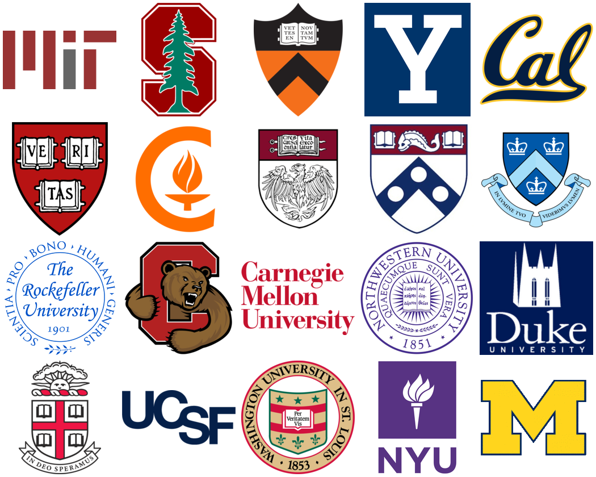

# Graduate Admissions Prediction

A pair of Streamlit apps that explore the Graduate Admissions dataset and estimate a student's chance of admission at US universities of different ratings, from their GRE and TOEFL scores, statement of purpose, letters of recommendation, CGPA and research experience.



## The data

The [Graduate Admissions dataset](https://www.kaggle.com/datasets/mohansacharya/graduate-admissions) (Kaggle) has 500 profiles of Indian students applying to graduate programmes, with eight attributes and the chance of admission between 0 and 1.

| File | Contents |
|---|---|
| `dataset/gad.csv` | The original dataset: GRE (out of 340), TOEFL (out of 120), university rating (1 to 5), SOP and LOR (out of 5), CGPA (out of 10), research (0 or 1), chance of admission |
| `dataset/ie_gad.csv` | The same data with an IELTS band derived from each TOEFL score |
| `dataset/gpa_gad.csv` | The same data with CGPA converted to a 4-point scale |

## The model

A linear regression of the chance of admission on GRE, TOEFL, IELTS, university rating, SOP, LOR, CGPA and research, fitted on `dataset/ie_gad.csv`. It explains about 82% of the variation on a 20% hold-out set (R-squared 0.82). For a given profile, the apps predict the chance of admission at each university rating from 1 to 5 and mark ratings with a predicted chance of 70% or more as realistic options.

The model is trained when the app starts, so there is no saved model file to download.

## Running the apps

Requires Python 3.11 or later.

```bash
pip install -r requirements.txt
streamlit run app/app.py           # dataset exploration, charts and the prediction model
streamlit run app/predict_app.py   # prediction only
```

## Files

| File | Contents |
|---|---|
| `app/app.py` | Exploration app: raw data, summary statistics, count and distribution plots, and the prediction model |
| `app/predict_app.py` | Prediction-only app |
| `app/model_utils.py` | Shared data loading, TOEFL-to-IELTS conversion and model training |
| `images/` | Figures used in the apps |

## Authors

[Sai Mihir Jakkaraju](https://github.com/saimihirj) and [Rushab Prakash Kulkarni](https://github.com/rushab14).

## License

GPL-3.0. See [LICENSE](LICENSE).
